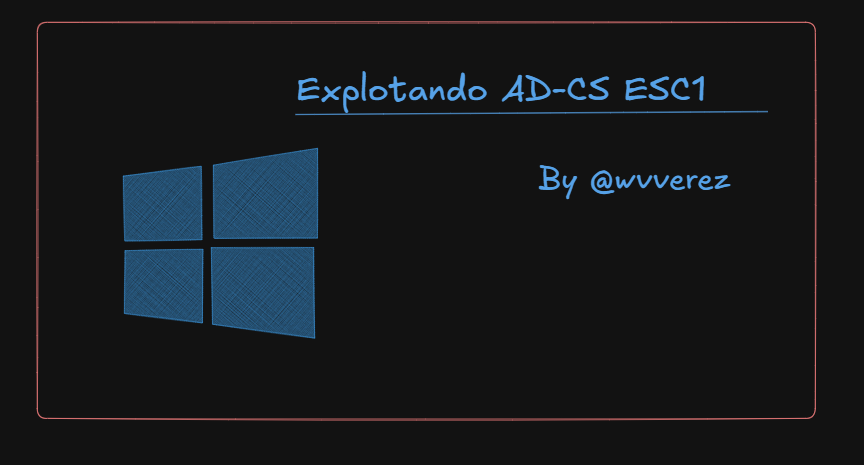

  

  <strong style="color: #ff4444;">[+] DISCLAIMER</strong>  
  Todo el contenido, información, ejemplos o conocimientos presentados en este sitio tienen <strong>exclusivamente fines educativos, formativos y éticos.</strong>  
  El objetivo es promover el aprendizaje y la comprensión responsable de los conceptos explicados. <strong>No se pretende fomentar, facilitar ni promover actividades ilegales, dañinas o no autorizadas.</strong>

Bienvenidos a este nuevo post en el que vamos a ver como abusar de AD-CS en el vector ESC1, para empezar voy a definir que es AD-CS, es un rol de Windows Server que convierte un entorno de Active Directory en una Infraestructura de `Clave Pública (PKI)` corporativa.

En lugar de adquirir certificados a entidades externas como `Let's Encrypt` por ejemplo, esa misma organización actúa como Autoridad Certificadora (CA) y da certificados digitales para sus usuarios, equipos y servicios.

Usos en Entornos Reales:

`Autenticación`: Inicio de sesión mediante Smart Cards o certificados en equipos clientes sin necesidad de introducir contraseñas.

`Cifrado de correo (S/MIME)`: Firma y cifrado de mensajes internos.

`HTTPS`: Certificados SSL/TLS para intranets y servicios corporativos.

`VPN y Wi-Fi empresarial (802.1x)`: Validación de acceso de dispositivos corporativos.

`Firma de código`: Firma digital de binarios y scripts internos.

`IPSec`: Cifrado del tráfico entre servidores.

Tiene varios componentes clave, entre ellos está la autoridad de Certificación (CA) que puede ser `Enterprise CA` que sería integrada con Active Directory. Publica las plantillas y los certificados en el directorio y permite el enrolamiento automático. y después `Standalone CA` que es independiente de Active Directory, orientada a entornos aislados.

Jerárquicamente se divide en `Root CA` (raiz) y Subordinate / Issuing CAs (que son las emisoras).

Después tenemos las plantillas de certificado (certificate templates) que definen la directiva de emisión de un certificado. 

También esta el que tiene permiso para solicitarlo (Enrollment Rights). El proposito de uso definido por `EKU` (Extended Key Usage) como Client Authentication, Server Authentication o Code signing. También importante el periodo de validez y renovacion, si requiere aprobación manual de algún administrador.

# ¿ Por que AD-CS suele ser más vulnerable ?

Un certificado digital con el eku de `Client Authentication` es equivalente a conocer la contraseña de una cuenta, te permite autenticarte con protócolos como `PKINIT` para sacar un `ticket granting ticket` (TGT) kerberos o el hash NTLMv2 de esa cuenta.

Si una plantilla permite que el solicitante defina la identidad y la inscripción a usuarios comunes (Domain Users o Authenticated Users), un atacante con una cuenta básica puede solicitar un archivo del Domain Administrator y así compromete todo el dominio.

# 1. Instalación de AD-CS en Windows Server
